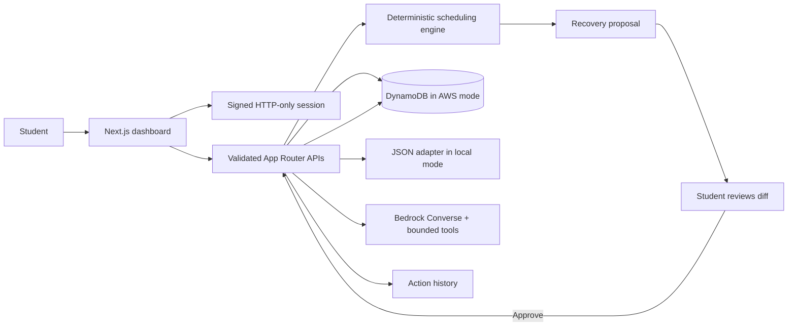

# CampusMate AI

CampusMate is a student planning workspace built with Next.js App Router, TypeScript, Tailwind CSS, and AWS SDK v3. The central workflow is to save tasks, propose a schedule, recover when time is lost, review the changes, and approve before applying them.

## Run locally

Requires Node.js 20+ and npm. Node 24.19.0 and npm 11.17.0 were used for this workspace.

```powershell
cd campusmate-ai
npm install
Copy-Item .env.example .env.local
npm run dev
```

Open http://localhost:3000 and create an account. Local development stores data as JSON files in `.local-db`; this is persistent across refreshes but is **not DynamoDB**. The local assistant is deterministic keyword logic; it is **not a live language model**. `USE_LOCAL_DB=true` and `USE_LOCAL_AI=true` make that mode explicit.

Checks:

```powershell
npm run typecheck
npm run lint
npm test
npm run build
```

## Environment and deployment

See `.env.example`. Set a unique `AUTH_SECRET` in production. The app signs a seven-day, HTTP-only, SameSite=Lax session cookie; it uses `Secure` cookies in production. Passwords are hashed with bcryptjs. Never use the local fallback for production.

For real AWS mode, configure the standard AWS credential provider chain (developer profile locally, execution role in deployment), set `AWS_REGION`, and unset `USE_LOCAL_DB` / `USE_LOCAL_AI`. `AWS_REGION` selects real service calls; missing credentials, permissions, tables, or Bedrock model access return errors and do not switch to local data. Configure `BEDROCK_MODEL_ID` to a model enabled for your AWS account and region. Bedrock Converse and validated tool definitions live in `lib/bedrock/`; tool iterations and output tokens are capped.

The CloudFormation definition in `infra/dynamodb-template.yaml` describes the users, tasks, schedules/proposals, history, availability, and roadmaps tables. It uses on-demand billing; users has an email lookup GSI. Core records use `pk=USER#<id>` and prefixed sort keys, so normal user reads are partition queries. Review the template, region, backups, and expected charges before deployment. No AWS resources are created by the app or these commands.

### IAM scope

Grant only `dynamodb:GetItem`, `PutItem`, `UpdateItem`, `DeleteItem`, and `Query` against the six named tables and the users email index. Grant `bedrock:InvokeModel` only for the configured model ARN. Avoid table scans and wildcard Bedrock permissions. Add CloudWatch log permissions only to the runtime role. The current task API uses DynamoDB directly through SDK v3; there is no deployed Lambda invocation in this repository yet.

### Vercel

Import this repository as a Next.js app and set `AUTH_SECRET`, `APP_BASE_URL`, `AWS_REGION`, the table names, and `BEDROCK_MODEL_ID` in the Vercel project environment. Provide AWS credentials through a supported secure deployment identity/credential broker; do not put long-lived access keys in browser variables. Vercel deployments must use real DynamoDB because local JSON files are not durable across serverless instances. Deploy tables separately after reviewing the CloudFormation template.

## How the workflow works



The Recovery Mode endpoint persists proposals by owner, expires them after 30 minutes, and recalculates against current tasks and availability when the student approves. Unfinished work is rescheduled by the deterministic engine; unschedulable tasks are returned as conflicts. The dashboard displays proposed time and unschedulable reasons before approval.

## Hackathon track notes

- **Alexa+ simulated experience route:** the web assistant demonstrates a conversational student assistant, tool calls, task state, and recovery. This is a simulation and is not an official Alexa+ integration. No private preview or partner-only API is used.
- **AWS Builder mini-challenge:** AWS mode has real Bedrock Converse and DynamoDB SDK adapters, selected by server environment. Local mode does not count as AWS usage. Runtime AWS evidence requires deployment with account permissions and configured resources.
- **Lambda:** no Lambda function is currently invoked by the web app. The current server-side operation layer is Next.js API routes. Do not claim Lambda as an integrated runtime service yet.

## Demo script (3 minutes)

1. Register and add an assignment due soon plus a lab task; show each saved task in My Tasks and Activity History.
2. Open Recovery Mode, enter lost time, and build a proposal. Explain the current/proposed slots and any impossible deadline.
3. Reject once to demonstrate student control, then create a fresh proposal and approve it. Refresh and show the saved result and history.
4. Open the assistant. In local mode, identify it as deterministic development fallback; in AWS mode, show tool results only after AWS access is configured.

## Current scope and limitations

- Implemented: responsive dashboard, registration/login/logout, owner-scoped task CRUD and completion, activity history, deterministic schedule generation, Bedrock Converse tool orchestration, local JSON persistence, DynamoDB adapters, and approval-gated recovery proposals.
- The task availability records currently default to 9–4 class and 4–10 study time when no saved records exist. A user-facing availability editor is not yet implemented.
- Career Mission currently provides a career-goal entry point and roadmap framing; roadmap generation, editing, and tracking are not implemented.
- The activity panel is real for stored actions. Recovery application records an executed record after task changes; DynamoDB multi-item transactions and concurrent schedule version checks are not implemented.
- Recovery proposals persist in the schedules table/local adapter. The standard agent tool executor still uses an in-memory proposal cache for its tool-only scheduling workflow; use the Recovery Mode API for persistent approval-gated recovery.
- Vitest covers the deterministic scheduler. A Playwright browser flow covers registration, task creation/completion, and persistence after refresh. AWS credentials and a deployed AWS account were not available for service verification.

## Next deployment steps

1. Choose an AWS region and review `infra/dynamodb-template.yaml` and its on-demand costs.
2. Deploy the reviewed stack with CloudFormation; this is a paid-resource action and is intentionally not automated here.
3. Configure least-privilege IAM and Bedrock model access for the chosen account/region.
4. Set production environment variables and `AUTH_SECRET` in the hosting provider.
5. Run the checks above, then verify registration, task ownership, recovery approval, and AWS service calls in the deployed environment.
